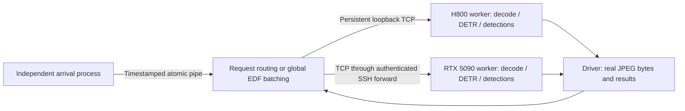

# Where Should We Batch?

**A real two-host DETR inference service comparing request routing plus local
batching against global batching with GPU-only or end-to-end service estimates.**

This is the CISC8003 Cloud and Distributed Systems research project. It extends
the completed [CISC8005 visual inference systems project](https://github.com/crycryout/cvprcourseproject).
The old visual project and this distributed experiment have separate protocols,
frozen configurations and results. Current evidence status: [docs/STATUS.md](docs/STATUS.md).

Read the English [report](results/report.pdf) ([Markdown](results/report.md)),
[12-slide presentation](results/slides.pdf), and [evidence index](results/README.md).
The release contains 120 paired two-host cases, 48 single-host controls and ten
full 4000-image detection-quality evaluations.

The measured global E2E heuristic **did not improve** deadline goodput: its
across-grid mean is 13.000 requests/s versus 112.524 for WRR, the strongest measured
routing baseline, a decrease of 88.4%. This describes the frozen bounded policies
on this load grid; it does not establish a limit on global batching in general.
All five policies, seeds, loads and negative results remain in the report.

## Architecture and research question



Does grouping requests before routing improve deadline goodput, and does an
end-to-end service curve outperform a GPU-only estimate on heterogeneous workers?
Five policies share one pretrained FP32 detector, image contract and graph executor:
round-robin (RR), capacity-weighted routing (WRR), shortest estimated completion
(SECT), global batching with GPU-only profiles, and global batching with E2E profiles.
Global batching, EDF and deferred scheduling are established techniques. This
project provides a controlled implementation and empirical extension, not a claim
to invent them. [Protocol](docs/PROTOCOL.md).

## Verify the published evidence

With Python 3.10 and `numpy==1.26.4` installed, this audit needs no GPU, checkpoint or COCO images:

```bash
PYTHONPATH=src python scripts/verify_results.py
```

The protocol tests are CPU-only:

```bash
PYTHONPATH=src python -m pytest -q
```

## Reproduce real inference

Use Python 3.10 on both machines and install `configs/requirements.lock.txt` in
isolated virtual environments. The measured environments use identical PyTorch,
Transformers, CUDA build and cuDNN packages; do not replace system drivers.
Each host needs a compatible full NVIDIA GPU. Source must be identical on both.

1. Prepare official COCO validation and the immutable DETR weights on the driver:

   ```bash
   PYTHONPATH=src .venv/bin/python scripts/prepare_data.py
   ```

   It downloads official sources and creates the original 1000/4000 split and
   pinned weights.

2. Copy only the repository source and `checkpoints/` to the remote worker. Remote
   workers receive JPEG bytes over RPC and need no dataset copy.

3. Start the task-owned workers and SSH forward. Keep the launcher running in a
   terminal or an execution session:

   ```bash
   PYTHONPATH=src .venv/bin/python scripts/manage_workers.py start \
     --remote-alias YOUR_SSH_ALIAS --remote-root CISC8003Project
   ```

   It first checks both hosts for GPU work, binds workers to loopback, writes the
   ignored local endpoint file and records aggregate GPU reservation time. It
   stops this project's workers if another GPU process appears or the budget is
   reached. It does not alter other users' jobs, networking, clocks or drivers.

4. In a second terminal, run `bash scripts/reproduce.sh`. A fresh output root
   calibrates and freezes before evaluation, measures all requests, then creates
   the report and figures in `results-reproduction/`. The script stops its workers
   before exporting resource evidence, including on failure. Existing results are
   never overwritten by calibration.

5. Stop only this project's processes:

   ```bash
   PYTHONPATH=src .venv/bin/python scripts/manage_workers.py stop
   ```

To resume an existing freeze, run `batchserve.experiments quality`, `matrix` or
`controls` with `--output YOUR_EXISTING_ROOT`. Completed configurations are reused
only after their freeze identity is checked. Inspect partial/failed cases first.

## Evidence and scope

Synthetic Poisson/burst arrivals replay real COCO JPEGs. Timing starts at scheduled
arrival and ends when decoded detections reach the driver. Network, SSH transport,
CPU preprocessing, queues, copies, GPU inference and return decoding are included.
Only the image-byte disk read and model initialization are outside request timing.
Rejects, failures and drain-censored requests remain in the SLO denominator.

The arrival emitter runs in an independent CPU process. Producer emission lag and
router pickup delay are recorded separately; E2E includes both. The original
cooperative-generator timing epoch was invalidated rather than relaxing its lag
threshold. Unchanged-executor AP can be retained with the published
`quality_compatibility.json`, origin source/configuration and preserved original
measurement IDs. A fresh reproduction evaluates AP normally; no retention shortcut
is required.

Publishable files contain small metrics, hashes, figures and reports. Raw request
traces, JPEGs and weights remain local; reproduction regenerates them. A source
freeze and file checksums make changes visible but cannot independently prove the
truth of unpublished raw measurements. The local audit additionally recomputes
all request-level metrics before exporting.

## Provenance and AI assistance

`src/cvpr_project` is an unchanged snapshot from the author's own repository at
commit `91ccf56`; [configs/upstream.json](configs/upstream.json) records every
copied file hash. `src/batchserve` implements the new transport, heterogeneous
adapter, scheduling, calibration and experiments. The v2 H800-only guard remains
unchanged; the extension's adapter explicitly supports both measured GPUs.
PyTorch, Transformers, Pillow, NumPy and pycocotools retain their upstream licenses.

Implementation, tests, experiments and report generation were assisted by Codex.
All numerical claims must come from recorded real inference. The author reviews
and submits coursework; this repository does not claim instructor approval or
submit anything automatically.

Direct related work: [Nexus (SOSP 2019)](https://yuchenjin.github.io/papers/sosp19-Nexus.pdf),
[Clockwork (OSDI 2020)](https://www.usenix.org/conference/osdi20/presentation/gujarati),
and [Symphony](https://arxiv.org/abs/2308.07470), whose deferred batching and network
analysis are especially close to this project's mechanisms.
