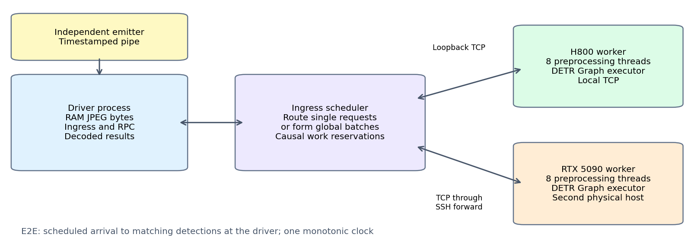
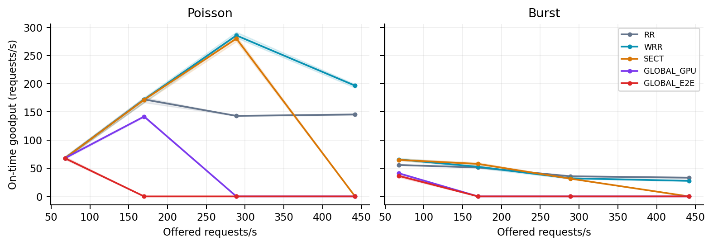
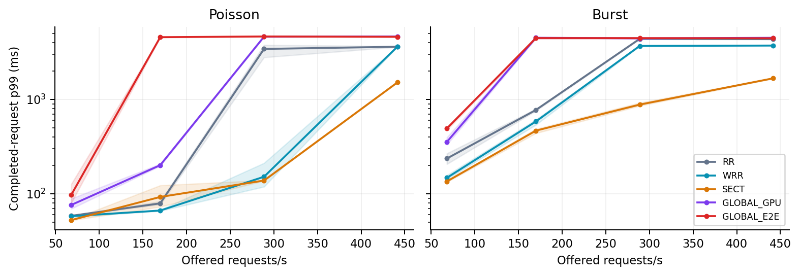
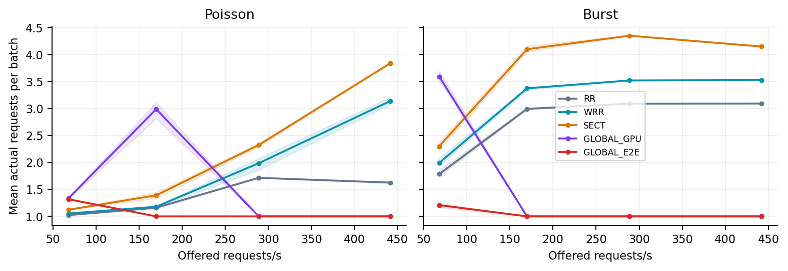
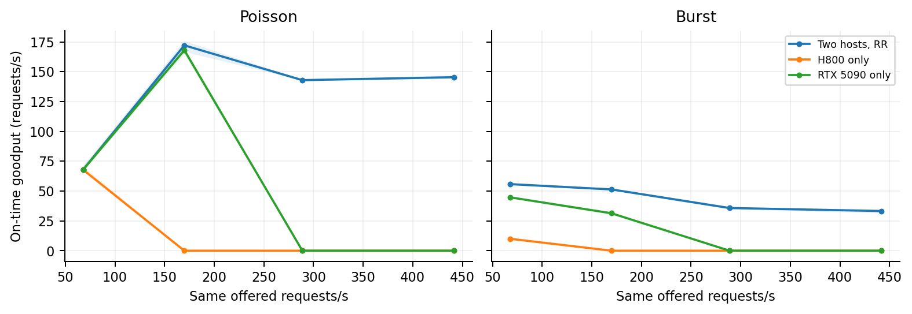

# Where Should We Batch?
## Coordinating request routing and batching for heterogeneous object detection serving

### Abstract
We implement and evaluate a real two-machine DETR inference service that compares
three request-routing policies with worker-local batching against two global
batching policies. The latter differ only in whether dispatch decisions use GPU
forward profiles or end-to-end RPC service profiles. Across 120 paired
two-host configurations and 48 single-host controls, global E2E
batching did not improve mean deadline goodput relative to the strongest measured routing
baseline (WRR): 13.000 versus 112.524 requests/s
(-88.4%). Ten independent 4000-image evaluations establish a maximum
absolute within-worker AP change of 0.000116 percentage points. The study
uses real COCO JPEGs and synthetic open-loop arrivals, preserves all offered
requests in the SLO denominator, and releases source, frozen configurations and
auditable small evidence. Results apply to this workload and two-host platform.

### 1. Problem and research questions
In a replicated inference service, routing an image immediately to a worker can
reduce that worker's queueing delay but can fragment opportunities to form larger
GPU batches. Global batching pools arrivals, but its waiting and dispatch decisions
depend on an estimate of remaining work. A GPU forward estimate omits CPU decode,
image transformation, packing and communication; a conservative E2E estimate can
also reduce the batch sizes considered feasible under short deadlines. We ask:
RQ1, how do global and worker-local batching compare at the same offered load?
RQ2, what changes when the global scheduler uses an E2E rather than GPU-only
service curve? RQ3, how does scale-out compare with each single worker at the same
arrival trace? Adding a worker is measured, not assumed to improve every metric.

The completed CVPR course project supplies the immutable detector and executor.
Its deadline heuristic had lower batch occupancy and goodput than its tuned FIFO
baseline. That observation motivated this experiment; it is not evidence that
distributed routing itself causes degradation. This extension introduces real
network transport, heterogeneous workers, global scheduling and independent
two-host measurements, while retaining separate protocol and result identities.

### 2. Related work and contribution boundary
Nexus [1] studies batching-aware allocation and execution for DNN video analytics.
Clockwork [2] exploits predictable inference execution for request-level SLOs.
Symphony [3] is the closest mechanism: it studies deferred batch scheduling,
load-proportional GPU consolidation, scalable coordination and network latency.
Consequently, global batching, EDF, deferred dispatch and service profiling are
prior work. Our contribution is a controlled implementation and empirical extension
using real DETR image processing, heterogeneous workers, identical executors and
an all-offered E2E latency contract. The global policies are simplified bounded
heuristics, not full reproductions of Symphony, Nexus or Clockwork. We do not
claim algorithmic priority or superiority over their complete implementations.

### 3. System design

The driver and ingress scheduler run in one process on the H800 host. The driver
caches compressed JPEG bytes in RAM and sends actual bytes over persistent framed
TCP. The H800 worker is reached over loopback. The remote RTX 5090 worker is
reached through an authenticated SSH TCP forward; encryption and physical network
cost remain in the measured request path. Workers bind loopback and return the
complete threshold-zero detections, not acknowledgments or cached outputs.

An independent CPU process emits scheduled arrival notifications through a
nonblocking atomic pipe. Its pre-write monotonic timestamps measure producer lag;
the router separately records notification pickup delay. A full pipe causes
producer lag rather than hiding backpressure. Router JSON decoding cannot block
the producer's clock. E2E still begins at planned arrival and charges producer
lag, pickup delay and all subsequent work. The validity threshold applies to
producer emission lag; router delay remains part of the measured system.

Every request is identified by request ID, image ID and JPEG SHA-256. The receiver
checks the image bytes and dimensions. Worker CPU pools decode and transform each
arrival independently. The frozen CVPR executor owns fixed host/device buffers,
two slots per batch bucket and one GPU compute stream with explicit copy events.
One batch may execute while one is prefetched. A slot is released only after D2H
and CPU postprocessing have consumed its output. Graphs are local to each process
and GPU, never serialized or shared across machines. The original H800-only guard
is unchanged; a derived adapter generalizes device initialization and inherits the
same preprocessing, forward and output decoding methods.

Global batch membership is fixed before worker preprocessing, so the group waits
for every selected image to become ready. Local batching draws from already-ready
preprocessing jobs. Comparing these architectures includes a different readiness
barrier and cannot isolate batch fragmentation alone. The GPU-only/E2E ablation
within the global architecture retains identical readiness semantics. The global
two-outstanding-batch cap can also limit CPU admission at small batch sizes,
whereas local input queues can keep preprocessing jobs populated. Both retain
the same two-slot GPU execution limit and eight preprocessing threads.

RR sends individual arrivals alternately. WRR uses smooth weights proportional to
the best calibrated requests/s of each worker. SECT chooses the worker with the
lowest virtual predicted finish, updating reservations synchronously at dispatch.
These three policies use worker-local FIFO ready-queue batching with identical
calibration search budgets. GLOBAL_GPU and GLOBAL_E2E maintain an EDF global
queue and enumerate worker/bucket candidates for EDF prefixes. Feasible candidates
meet the earliest selected deadline under the chosen service table; the policy
maximizes requests per estimated service time, with deterministic ties. If no
candidate is feasible it serves the earliest request at batch one. It never drops
expired requests. The common waiting cap is absolute from the oldest arrival,
so new arrivals cannot reset it. At most two batches are outstanding per worker.
These are empirical heuristics, without a deadline guarantee.

### 4. Experimental method
Hardware is one full NVIDIA H800 PCIe (114 SMs, 85.02 GB device memory) and one
NVIDIA GeForce RTX 5090 (170 SMs, 33.66 GB). Both use PyTorch 2.14.0+cu130,
Transformers 4.46.3 and cuDNN 92400. H800_worker: Intel(R) Xeon(R) Gold 6342 CPU @ 2.80GHz, 96 logical CPUs, Python 3.10.12, NVIDIA driver 580.178.04; RTX5090_worker: Intel(R) Core(TM) Ultra 7 265K, 20 logical CPUs, Python 3.10.21, NVIDIA driver 595.58.03.
Eight CPU preprocessing threads per worker are fixed. Hardware differences include
the host CPUs and transport, so results are about heterogeneous whole workers,
not an isolated causal comparison of the two GPU chips. No clocks, MIG settings,
drivers or unrelated workloads are modified. An isolation monitor stops our own
workers if foreign GPU computation appears.

Weights are the frozen facebook/detr-resnet-50 detector [5] revision
70120ba84d68ca1211e007c4fb61d0cd5424be54. Inference uses FP32 with TF32 off,
shortest-edge 480 / longest-edge 640 resizing, 640x640 padding and pixel masks.
COCO [6] official validation is partitioned with PCG64 seed 20261008 into 1000
calibration and 4000 evaluation images. This is a project subset split, not an
official test split. The previous project already evaluated these images; this
extension is not a claim to have an entirely unseen external dataset. New runtime
parameters are chosen using calibration images and frozen before new evaluation.

Service curves use 40 post-warmup batch samples per worker/bucket and their p95.
Local batching searches max batch in 1/2/4/8 and timeout in 0/1/2 ms, with equal
candidate and trace budgets on each worker. After measuring saturated capacity,
all local candidates are rechecked once at 0.5/0.85/1.3 of each worker's observed
steady-window completion rate. The common load reference is retained after this
recheck rather than iterated. The selected settings are worker 0: max batch 2, timeout 2 ms; worker 1: max batch 8, timeout 2 ms.
Global wait caps 0/2/5/10 ms are evaluated with equal budgets for both estimators;
the common selected cap is 5 ms. A separate backlogged WRR
calibration establishes lambda_ref=339.733 requests/s from
actual completions during a 15-second steady window after five seconds warmup.
Common offered rates are 67.947, 169.867, 288.773, 441.653 requests/s,
or 0.2/0.5/0.85/1.3 times that reference. These labels do not imply equal utilization
for all methods or both single-worker controls.

Each policy runs Poisson and one-second burst arrivals with paired seeds
17/42/2026 at each load: 120 two-host cases. Bursts place Poisson arrivals in the
first 200 ms at five times the mean rate. Single-worker controls contribute 48
additional cases. Every case has 5 seconds warmup,
30 seconds of measurement arrivals and up to 30
seconds drain. SLO classes are 107.07, 214.14, 428.28
ms with probabilities 50/30/20 percent, independent of image content. They are
calibration-normalized research SLOs. Policy order is deterministically randomized.

E2E is matching detections decoded at the driver minus scheduled arrival on the
same monotonic clock. It includes generator lag, scheduler wait, JPEG transmission,
CPU queues/preprocessing, packing/copies, forward, postprocessing and return data.
Worker durations use a separate clock and are never subtracted from driver times.
Goodput is on-time completions from the measurement-arrival cohort divided by
measurement seconds. SLO success uses every offered cohort request, including
rejects, errors, late completions and unfinished drain. Completed percentiles are
reported with completion ratio. A common 512-request pending cap rejects newest
arrivals. No policy selectively drops expired images. All valid runs pass the
predeclared generator-lag threshold. Formal timing runs have no profiler attached.

### 5. Results
The following values are arithmetic means over 24 common trace configurations
per policy. They summarize this grid, not a universal workload distribution.
The strongest routing baseline is identified descriptively from the same table;
all policies and paired per-seed results remain published.

| Policy | Mean goodput (r/s) | Mean SLO success (%) | Mean batch occupancy |
| --- | --- | --- | --- |
| RR | 88.065 | 51.75 | 2.060 |
| WRR | 112.524 | 60.91 | 2.471 |
| SECT | 84.211 | 54.51 | 2.947 |
| GLOBAL_GPU | 31.338 | 30.36 | 1.614 |
| GLOBAL_E2E | 13.000 | 19.17 | 1.066 |

The E2E global variant did not improve the strongest routing baseline by this aggregate
metric (-88.4%). The global estimator ablation changes only its service
table while retaining algorithm, waiting cap, executor, traffic and workers.
Differences in observed occupancy and queue stages help explain what each policy
actually executed. They do not identify every possible causal mechanism, and a
negative result is retained without retuning on the evaluation set. Per-load
curves matter because an across-grid mean can hide different operating regimes.

For RQ2, GLOBAL_E2E minus GLOBAL_GPU averages
-18.337 requests/s across the 24 paired cases.
GLOBAL_E2E wins 0, loses 7, and ties 17
cases (absolute goodput difference within 1e-9 counts as a tie). This is a
descriptive service-table ablation; the three trace seeds do not establish
statistical significance or a generally superior estimator.

The next table reports means of per-run fractions. The first column of fractions
uses unique completed batches; the second uses completed requests. Neither is an
all-offered success measure, and both should be read alongside completion ratios.

| Policy | Single-request batches (%) | Already expired at driver dispatch (%) |
| --- | --- | --- |
| RR | 37.70 | 0.00 |
| WRR | 34.23 | 0.00 |
| SECT | 34.48 | 0.00 |
| GLOBAL_GPU | 77.85 | 63.03 |
| GLOBAL_E2E | 94.67 | 78.73 |

The implementation falls back to batch one when its EDF head has no predicted
feasible placement. Expired heads can therefore limit batching, while the global
two-RPC cap also bounds how many images can enter CPU preprocessing. The observed
fractions are diagnostics, not a controlled ablation of either mechanism.
Testing alternative admission, expiration and fallback rules requires a new
calibration/freeze and is left to follow-up work.

The scale-out figure compares RR on two hosts with the same local batching on
each single host. It separates the question of adding capacity from selecting a
new global policy. This small cluster cannot establish large-fleet scalability.

For RQ3, this table averages the six paired traces (two arrival types and three
seeds) at each offered rate. The final column compares two-host RR with the
better single host at that rate. The reference-rate labels are common loads,
not equal per-topology utilization.

| Offered r/s | Two-host RR goodput | H800 goodput | RTX 5090 goodput | Change vs best single (%) |
| --- | --- | --- | --- | --- |
| 67.947 | 61.867 | 38.878 | 56.328 | +9.8 |
| 169.867 | 111.722 | 0.000 | 99.689 | +12.1 |
| 288.773 | 89.356 | 0.000 | 0.000 | undefined |
| 441.653 | 89.317 | 0.000 | 0.000 | undefined |

The following stage values are means of per-run medians. CPU and driver statistics
sample requests; GPU statistics deduplicate batches. RPC elapsed and GPU spans
overlap other stages, so their sum is not an E2E reconstruction.

| Policy | Driver queue ms | CPU queue ms | Preprocess ms | GPU forward ms/batch | RPC elapsed ms |
| --- | --- | --- | --- | --- | --- |
| RR | 0.41 | 26.14 | 20.55 | 11.10 | 736.22 |
| WRR | 0.42 | 34.81 | 17.66 | 11.38 | 198.48 |
| SECT | 0.41 | 43.17 | 17.21 | 10.90 | 442.00 |
| GLOBAL_GPU | 2539.40 | 0.64 | 13.73 | 9.19 | 43.61 |
| GLOBAL_E2E | 3071.66 | 0.33 | 11.57 | 7.86 | 30.07 |

### 6. Vision quality and numerical correctness
Worker 0 is the H800 and worker 1 is the RTX 5090.

Before evaluation, each worker passes at least 1024 calibration request comparisons
between same-worker eager and Graph logits/boxes at atol 1e-5 and rtol 1e-4.
Tests cover all buckets, partial occupancy, reordered image identities and two
simultaneously outstanding independent graph slots. Request IDs and image hashes
are checked throughout real RPC replay. Ten independent offline quality runs
evaluate all 4000 images: eager b1 and Graph b1/b2/b4/b8 on each worker. AP includes
all images regardless of online completion or deadline success. No NMS or
visualization threshold changes are introduced.

| Worker | Backend | Bucket | AP (%) | Delta vs same-worker eager (pp) |
| --- | --- | --- | --- | --- |
| 0 | eager | 1 | 36.311754 | +0.000000 |
| 0 | graph | 1 | 36.311754 | +0.000000 |
| 0 | graph | 2 | 36.311865 | +0.000112 |
| 0 | graph | 4 | 36.311673 | -0.000081 |
| 0 | graph | 8 | 36.311744 | -0.000010 |
| 1 | eager | 1 | 36.312184 | +0.000000 |
| 1 | graph | 1 | 36.312184 | +0.000000 |
| 1 | graph | 2 | 36.312068 | -0.000116 |
| 1 | graph | 4 | 36.312188 | +0.000005 |
| 1 | graph | 8 | 36.312277 | +0.000093 |

Maximum absolute within-worker AP change is 0.000116 pp, against the fixed
0.1 pp acceptance threshold. Different hardware may produce small floating-point
differences; this table verifies deployment semantics rather than claiming a new
detector or higher recognition accuracy.
The AP spread across all workers/backends/buckets is 0.000604 pp.

The final timing harness uses an independent timestamped arrival process after a cooperative-event-loop generator exceeded its lag limit. All timing cases were recalibrated and rerun. The ten genuine AP evaluations and 1024-request numerical checks are retained from the preceding campaign, whose original measurement freeze IDs (7aa056c109b2) remain unchanged. A published compatibility certificate verifies identical inference, transport, image-packing and quality code, weights, split and per-worker hardware/software. Offline AP does not use the arrival generator. A further 64-request-per-worker numerical and concurrent-slot sanity check passed in the rebuilt worker processes. The origin configuration and benchmark source are included for a self-contained CPU-only provenance audit.

### 7. Reproducibility, resources and limitations
The release includes source provenance, exact package versions, source/config
freeze, 120 per-run two-host metrics, 48 controls, quality tables, request-log hashes
and a CPU-only validator. Before export, every request log is independently
recomputed for offered counts, on-time completions, quantiles and batch occupancy.
The raw JPEGs, weights, full request logs, private endpoints and credentials stay
outside Git. Published hashes expose changes but cannot independently establish
unpublished measurements; reproduction regenerates the raw evidence. Resume
rejects mismatched freezes and retains failed attempts rather than overwriting.

New aggregate GPU reservation cost at export is
7.0866 hours, including idle worker lifetimes,
capture and failed starts. The prior CVPR project used 12.473090 hours; its results
are not mixed with this experiment. The automated extension cap is 16 hours.
Resources are measured reservation time, not utilization-equivalent GPU-hours.

Limitations are a single fixed model/input shape, two physical workers, synthetic
arrival processes, calibration-normalized deadlines, a shared client/router process,
the asymmetric loopback versus SSH-forwarded transport, and three trace seeds.
Host CPUs are shared laboratory resources, rather than exclusively reserved
cores. Randomized policy order and seed ranges do not eliminate CPU interference.
Runs that exceed the predeclared producer-lag bound are preserved outside the
valid matrix and repeated with the same frozen configuration; selection does not
use latency or goodput. The published attempts record identifies such exclusions.
The policies do not implement router high availability or retry-based worker
recovery. Clock synchronization is not needed for E2E, but absolute cross-host
stage ordering is not inferred. No performance claims are made about production
traffic, large clusters, unmeasured Triton/TensorRT engines or complete prior systems.
Three seeds support paired descriptive comparisons, not high-confidence significance
claims. A runtime-source and configuration freeze provides a clear boundary for follow-up work.

### References
[1] Haichen Shen et al. Nexus: A GPU Cluster Engine for Accelerating DNN-Based
Video Analysis. SOSP 2019. https://yuchenjin.github.io/papers/sosp19-Nexus.pdf

[2] Arpan Gujarati et al. Serving DNNs like Clockwork: Performance Predictability
from the Bottom Up. OSDI 2020.
https://www.usenix.org/conference/osdi20/presentation/gujarati

[3] Lequn Chen et al. Symphony: Optimized DNN Model Serving using Deferred Batch
Scheduling. arXiv:2308.07470, revised 2024. https://arxiv.org/abs/2308.07470

[4] Original CVPR course implementation and measured v2 report.
https://github.com/crycryout/cvprcourseproject

[5] Nicolas Carion et al. End-to-End Object Detection with Transformers.
ECCV 2020. https://arxiv.org/abs/2005.12872

[6] Tsung-Yi Lin et al. Microsoft COCO: Common Objects in Context.
ECCV 2014. https://arxiv.org/abs/1405.0312

AI assistance: source, tests, orchestration and report generation were assisted
by Codex. The author reviews the work and handles course submission.
